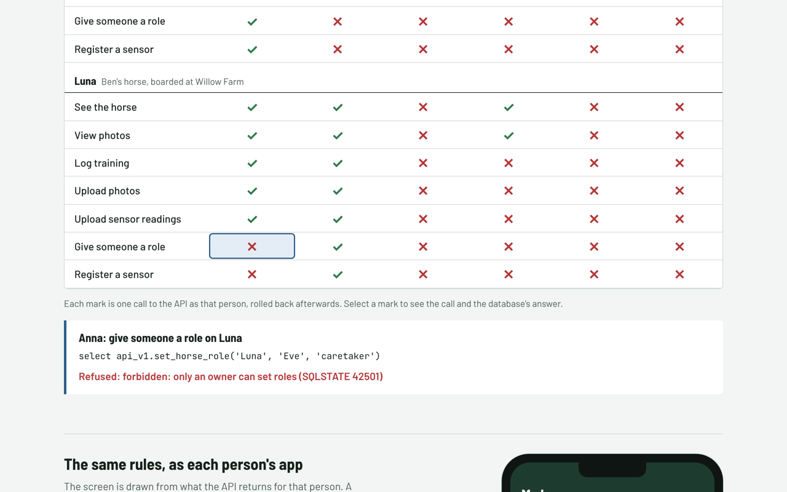
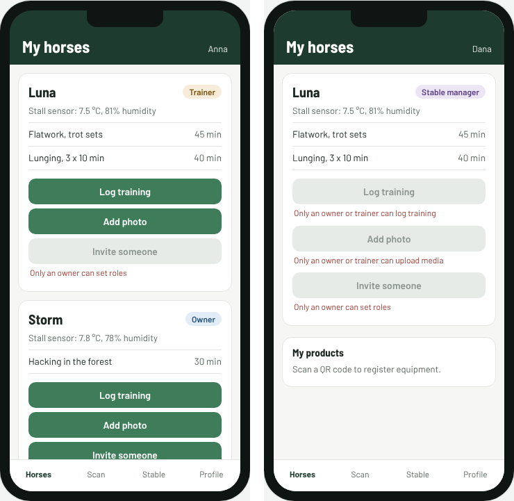

# Equestrian platform backend: the foundation

A Supabase/PostgreSQL backend foundation for a mobile platform where one person can be the **owner of one horse and the trainer of another**, with a Bluetooth sensor that records readings offline, QR product registration with a digital product passport, and reliable integrations with external systems. Written as versioned migrations and proven by 56 tests that run in-process, with no Supabase account or Docker.

**Try it live: [getupworkdev.github.io/equestrian-backend-demo](https://getupworkdev.github.io/equestrian-backend-demo/)**. The same migrations run in PostgreSQL inside your browser: a grid of who can do what (every mark is a real call), each person's app screen drawn from what the API returns, a QR passport scan, an offline sensor upload sent twice, and the outbox filling up.





```bash
npm install
npm test           # 56 tests, ~15 s
npm run contract   # regenerate docs/API_CONTRACT.md after changing the API
npm run pages      # refresh the live page's copy of the migrations
```

Everything here is fictional and generic: no client code, data or brand.

## What it shows

### One permission check, used everywhere

`app.has_horse_role(horse_id, roles[])` and `app.can_read_horse(horse_id)` in [`0001_foundation.sql`](supabase/migrations/0001_foundation.sql) are the only places permissions are decided. Every RLS policy calls them, every write function calls them. When the rules change (say, a stable manager gains write access), they change in one function and the test suite says what else moved.

| Role on a horse | Read | Log training | Grant roles | Register sensor |
|---|---|---|---|---|
| owner | yes | yes | yes | yes |
| trainer | yes | yes | no | no |
| caretaker | yes | no | no | no |
| stable manager (horse boarded at their stable) | yes | no | no | no |
| nobody | no | no | no | no |

[`tests/permissions.test.ts`](tests/permissions.test.ts) runs the scenario from the brief: Anna owns Storm and trains Luna; Ben owns Luna; Carl is Storm's caretaker; Dana manages the stable Luna is boarded at; Eve is nobody. Each test is a sentence like "caretaker Carl can read Storm but cannot log training", run as that user under RLS.

### A versioned API the app teams can build against

Clients never touch `app.*` tables directly: no insert, update or delete grants at all. They read `api_v1.*` views (which run under the caller's RLS) and call `api_v1.*` SQL functions for every write ([`0002_api_v1.sql`](supabase/migrations/0002_api_v1.sql)). Each function re-checks permissions itself and raises a named error (`forbidden: only an owner or trainer can log training`) that an app can map to a message. The contract is the SQL file, so iOS and Android can code against it before the backend is finished, and `api_v2` can exist beside `api_v1` later.

The tests also prove the policies can't be bypassed: direct writes to `app.*` are refused, a training-log id can't be re-pointed at another horse through the upsert, and the last owner can't remove themselves.

### Offline-first sync and the sensor ([`0003_sensors_and_sync.sql`](supabase/migrations/0003_sensors_and_sync.sql))

- **Idempotent batch upload.** The phone buffers readings and uploads `{seq, measured_at, temperature, humidity}` batches; `seq` is the device's own counter. Re-sending a batch after a timeout inserts nothing twice; the function returns `accepted`, `duplicates` and the highest `seq` stored, which becomes the phone's upload watermark. Batches over 5,000 are refused.
- **Monthly partitions**, created on demand by the upload function (in production a scheduled job creates them ahead).
- **Delta pull with tombstones.** `api_v1.changes_since(ts)` returns every horse, training log and device the caller may read that changed after the watermark, including deletions (soft deletes keep the row and set `deleted_at`, so a device that was offline learns about them). The views never show tombstones.
- **Client-generated ids** on training logs, so an offline write can be retried safely.

[`tests/sync.test.ts`](tests/sync.test.ts) covers the duplicate batch, the partially overlapping batch, partition creation, the stranger who can't upload, and the offline-then-sync sequence with an update and a deletion.

### QR product passport ([`0005_product_passport.sql`](supabase/migrations/0005_product_passport.sql))

- **Scan without an account.** `api_v1.passport(code)` is the one function `anon` may call. It returns the public passport (type, model, batch, materials, care, whether it is registered) and nothing about the owner.
- **Owner section for the owner only:** the horse it is attached to and the ownership history.
- **Registration is retry-safe** (the same owner registering again gets the same answer) and **can't be taken over**: a registered product only moves by `transfer_product` from its current owner.
- Attaching a product to a horse uses the same `has_horse_role` check: owner or trainer, not caretaker.

[`tests/passport.test.ts`](tests/passport.test.ts) also checks that a stranger's scan never contains the owner's name and that a failed write leaves no event behind.

### Integrations: outbox, webhooks, signed media URLs ([`0004_integrations.sql`](supabase/migrations/0004_integrations.sql), [`supabase/functions`](supabase/functions))

- **Transactional outbox.** Registering or transferring a product writes an event in the same transaction as the change. `outbox-dispatch` claims a batch (`FOR UPDATE SKIP LOCKED`, so two dispatchers never deliver the same event), sends each with an HMAC signature and `Idempotency-Key: outbox-<id>`, and records the outcome. Failures back off 30 s, 1 min, 2 min, ... and are marked dead after 8 attempts for a human to look at.
- **Inbound webhooks.** `webhook-receiver` verifies the signature on the raw body (with a 5-minute replay window and a constant-time compare) before parsing anything, then stores the event once per (provider, event id): a re-delivery is answered "duplicate" and not processed again.
- **Signed media URLs.** `horse-media-url` asks the database, as the user, whether they may read or upload a horse's photos (`api_v1.authorize_horse_media`, same permission check), then signs a short-lived Storage URL with the service key. The bucket stays private.
- The signature and delivery rules are plain modules in [`_shared`](supabase/functions/_shared), tested in [`tests/integrations.test.ts`](tests/integrations.test.ts) together with the backoff schedule and the permission checks.

### An API contract that can't drift ([`docs/API_CONTRACT.md`](docs/API_CONTRACT.md))

Generated from the database itself: each view's columns, each function's arguments and return type, who may call it (from the grants), and the errors it can raise (read from the function bodies), with descriptions kept as `COMMENT ON` in [`0006_api_docs.sql`](supabase/migrations/0006_api_docs.sql). CI fails if the committed contract and the migrations disagree, or if anything in `api_v1` is undocumented, so the iOS and Android developers always read the contract that actually runs.

## How the tests run without Supabase

[`tests/db.ts`](tests/db.ts) starts an in-process Postgres ([PGlite](https://pglite.dev)), applies the migrations in order, and runs each test block as a signed-in user the way PostgREST does: `set local role authenticated` plus `request.jwt.claims` carrying the user id. `auth.uid()` is shimmed to read that claim, so the same SQL runs on Supabase unchanged. CI runs the suite on every push ([`.github/workflows/ci.yml`](.github/workflows/ci.yml)).

## What is not here

The staging/production deployment pipeline (`supabase db push` and `supabase functions deploy` from GitHub Actions, per environment, with a manual approval for production) needs real Supabase projects and secrets, so it isn't simulated here. The Edge Functions are written for Deno and run on Supabase; their logic is tested here, their HTTP wiring is not.
